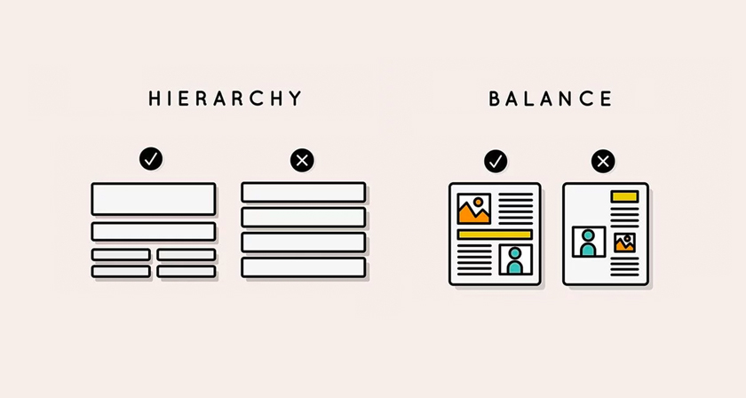

# Visual Hierarchy
*This project is [**Live on GitHub Pages**](https://noltron000.github.io/visual-hierarchy/).*

> Hi there! Thanks for visiting this mini project of mine.
> I made this static site during my studies in a class at college.

**Visual Hierarchy** is the concept that larger and more bold items appear to the human eyes first, even if it isn't the first to appear on a page.
Those items should likewise be the most important items on the page, in other words the title, the subheading, etcetera.

This project was made to study the concept of Visual Hierarchy.

This app was made to test simple HTML &amp; CSS code.
The project's coverage includes:
- Heading/Title
- Subheading
- Body paragraph
- Class styles
- Element styles
- Font
	- Style
	- Weight
	- Size
	- Color
	- Shadow
